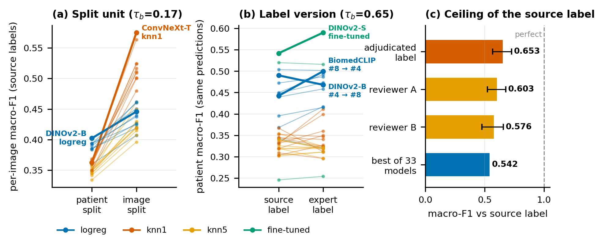

# Reliable Evaluation of Dental Imaging AI with OrthoBench and DentUnity


Code, protocols, aggregate results and reference weights for the MSc thesis
**Reliable Evaluation of Dental Imaging AI with OrthoBench and DentUnity**
(Hamzah Jasim Alomairi, Mohamed bin Zayed University of Artificial Intelligence, 2026).

Dental imaging models are usually compared as if every held-out image were an independent
case and its recorded label an adequate reference. This repository holds two benchmarks
built to test those assumptions. Each one changes a single part of an evaluation (the
reference label, the unit that is split, or the images that carry annotations) and holds
the rest fixed.



*OrthoBench. Left: per-image macro-F1 of 30 frozen models under a patient split and an image split. Middle: patient macro-F1 of 33 models scored against the routine (source) label and the expert label. Right: the adjudicated label, the two reviewers and the best model scored against the routine label.*

## Contents

1. [Overview](#overview)
2. [Main results](#main-results)
3. [Repository structure](#repository-structure)
4. [Installation](#installation)
5. [Quick start without data](#quick-start-without-data)
6. [Data](#data)
7. [Training and evaluation](#training-and-evaluation)
8. [Pre-trained models](#pre-trained-models)
9. [Where each result lives](#where-each-result-lives)
10. [Intended use and limitations](#intended-use-and-limitations)
11. [License](#license)
12. [Citation](#citation)
13. [Acknowledgments and contact](#acknowledgments-and-contact)

## Overview

| | [OrthoBench](orthobench/) | [DentUnity](dentunity/) |
|---|---|---|
| Images | 8,299 images of 962 orthodontic patients: intraoral photographs, panoramic radiographs and lateral cephalograms | 10,456 distinct images from two public releases: 4,527 intraoral photographs and 5,929 panoramic radiographs |
| Target | One Angle class (I, II or III) per patient: a routine label for all 962 patients and an expert-adjudicated label for the audited subset (240 patients reviewed, 231 with a final class) | Four tasks under one 36-concept taxonomy: photo classification (IO-CLS), photo detection (IO-DET), panoramic detection (PX-DET) and panoramic instance segmentation (PX-SEG) |
| Independent unit | The patient: all views of one patient stay on one side of a split | The copy lineage: a file and its detected re-exports receive one split across all four tasks |
| Question | How much does a model comparison change when the reference label or the split unit changes? | How much training exposure do the upstream splits carry, and what does it do to a score? |
| Released here | Code, protocol, leaderboard tables and aggregate results. No images and no patient records | Code, build kit (build script, manifests with splits and lineage ids, taxonomy), aggregate results and three model weights. No images |

A third directory, [experiments](experiments/), holds two controls that use both benchmarks.

## Main results

Values come from the result files listed [below](#where-each-result-lives). In those files
and in the figures, the routine label is named `source` or `manifest`, and the
expert-adjudicated label `adjudicated`, `final` or `expert`. DentUnity scores are
percentages.

**OrthoBench**

| Finding | Value |
|---|---|
| Agreement of two orthodontists on 230 audited patients | 164 of 230, Cohen's kappa 0.513 |
| Patients whose expert-adjudicated class differs from the routine record | 75 of 221 (33.9%, 95% CI 28.0 to 40.4) |
| Model pairs that change order when the same predictions are scored against the expert label | 93 of 528 (Kendall tau-b 0.648), 33 models, 189 patients |
| The same statistic after changing the labels of 64 randomly chosen test patients, the number the audit changed | Median Kendall tau-b 0.663 (central 95% range 0.545 to 0.761), 1,000 draws. The observed 0.648 lies inside this range |
| Leading model under both labels | Fine-tuned DINOv2-S, patient macro-F1 0.542 (routine) and 0.590 (expert) |
| Model pairs that change order between a patient split and an image split | 180 of 435 (Kendall tau-b 0.172), 30 frozen models |
| Mean gain in per-image macro-F1 from an image split | +0.160 one-nearest-neighbor, +0.078 five-nearest-neighbor, +0.048 linear probe |

**DentUnity**

| Finding | Value |
|---|---|
| Test images of the upstream panoramic split with a detected relative in training | 96.1% (0% under the joint lineage split, for links the graph recognizes) |
| Effect of substituting re-exports of test images into training, at fixed training size | Box mAP50-95 10.12 to 10.92 (+0.80), YOLO11n, two seeds |
| Photo classification (IO-CLS), 808 test photographs | 83.3 macro-AP (95% CI 76.3 to 90.1), validation-selected ensemble of a fine-tuned ConvNeXt-T and a multi-encoder frozen read-out |
| Photo detection (IO-DET) | 14.8 box mAP50-95, YOLO11n |
| Panoramic detection (PX-DET) | 13.5 box mAP50-95 with the planned YOLO11s; 14.1 with YOLO11m, added later |
| Panoramic instance segmentation (PX-SEG) | 8.7 mask mAP50-95, YOLO11s-seg |
| Transfer to DENTEX, DentUnity minus COCO initialization | +2.63 points (95% CI -0.64 to +6.01) with two seeds on 50 validation images; -0.08 (-1.20 to +1.06) under five-fold evaluation |

Detection and segmentation scores are means over two training seeds.

**Controls across both benchmarks**

| Finding | Value |
|---|---|
| Predicting from image width and height alone whether a classified photograph also has boxes | 41.3 AP against 17.8 for a constant score |
| Predicting from image width and height alone whether a panoramic radiograph lacks masks | 87.8 AP against 11.0 for a constant score |
| Rank reversals within and across prediction-head families, label change | 46 of 138 and 47 of 390 pairs |
| Rank reversals within and across prediction-head families, split change | 50 of 135 and 130 of 300 pairs |

## Repository structure

```
.
├── orthobench/                 Patient-linked orthodontic benchmark
│   ├── orthobench/             Package: manifests, splits, encoders, probes, statistics, fine-tuning
│   ├── scripts/                Feature extraction, benchmark runner, figures, follow-up analyses
│   ├── configs/                Default configuration
│   ├── dataset/                Protocol, leaderboard tables and aggregate results (CC BY-NC 4.0)
│   ├── results/                Aggregate JSON outputs
│   ├── figures/                Figures rendered from results/
│   ├── sample_data/            Synthetic fixtures, no patients
│   ├── tests/                  Unit tests
│   ├── analysis_plan.json      Frozen analysis plan with dated amendments
│   └── run_experiment.py       Command-line entry point
├── dentunity/                  Jointly split public dental dataset
│   ├── dentunity/              Package: inventory, taxonomy, lineage graph, splits, classifiers, detectors
│   ├── scripts/                Job queue, summaries, tables, figures, follow-up analyses
│   ├── dataset/                Build kit: build script, manifests, taxonomy, source terms (CC BY-NC 4.0)
│   ├── release/                Build instructions and licence table
│   ├── results/                Aggregate JSON outputs
│   ├── figures/                Figures rendered from results/
│   ├── weights/                Three reference models (AGPL-3.0)
│   ├── sample_data/            Synthetic fixtures
│   ├── plan.json               Frozen plan with timestamped amendments
│   └── run_experiment.py       Command-line entry point
└── experiments/                Evaluation controls that use both benchmarks
```

Each benchmark directory has its own README with further detail.

## Installation

Python 3.11 or later; a few DentUnity plotting scripts need 3.12. Every command block in
this README starts from the repository root.

```bash
git clone https://github.com/HJ701/orthobench-dentunity.git
cd orthobench-dentunity
python -m venv .venv
source .venv/bin/activate
pip install -r orthobench/requirements.txt -r dentunity/requirements.txt
```

The smoke tests, the unit tests and the evaluation controls need only the scientific
Python packages: for the quick start alone,
`pip install numpy pandas scikit-learn scipy Pillow` is enough. PyTorch is needed for feature extraction, fine-tuning and detector
training. The optional identifier screen (`phi-audit`) also needs the Tesseract 5 binary.

The OrthoBench runs used a single GPU with 16 GB of memory for feature extraction and
fine-tuning; the analyses on cached features run on CPU. On Apple silicon, set
`PYTORCH_ENABLE_MPS_FALLBACK=1` before the DentUnity runs.

## Quick start without data

These commands need no clinical data, no downloads and no GPU.

```bash
# OrthoBench: synthetic smoke run and unit tests
cd orthobench
python run_experiment.py smoke
python -m unittest discover -s tests -v
cd ..

# DentUnity: synthetic smoke run
cd dentunity
python run_experiment.py --smoke
cd ..

# Controls across both benchmarks (NumPy only)
python experiments/evaluation_controls.py orthobench dentunity
```

The last command recomputes the annotation-availability and rank-reversal controls from
the released manifests and leaderboard tables. Its reference output is
`experiments/evaluation_controls.json`.

## Data

### OrthoBench

Clinical images and case-level records are not included. The study is IRB approved,
with individual consent waived.
[`orthobench/dataset/`](orthobench/dataset/) holds the protocol, the leaderboard tables and
the aggregate results. Fitting the models requires the restricted images and the audit
workbook. Access to these clinical records is governed separately by their custodians:
this repository offers no download and no request route.
[`orthobench/README.md`](orthobench/README.md#data-access) records the current status, and
questions about access can be raised in an issue.

### DentUnity

DentUnity is released as a build kit. No image and no upstream annotation file is
re-hosted. You download the two public releases yourself, accept their terms, and the kit
rebuilds the benchmark by matching file contents (SHA-256) against the manifests.

```bash
cd dentunity
pip install kaggle        # needs a Kaggle account and API credentials
kaggle datasets download -d lokisilvres/dental-disease-panoramic-detection-dataset -p upstream/pano --unzip
kaggle datasets download -d salmansajid05/oral-diseases -p upstream/oral --unzip
python dataset/build/build_dentunity.py --pano-root upstream/pano --oral-root upstream/oral --out dentunity_v1
cat dentunity_v1/verify.json        # every entry of "matches_expected" must be true
```

Evaluate on the canonical files of the validation and test splits only. Re-exports may be
used for training only when their lineage is in the training split. Source terms are
documented in [`dentunity/dataset/SOURCES.md`](dentunity/dataset/SOURCES.md) and build
details in [`dentunity/dataset/README.md`](dentunity/dataset/README.md).

## Training and evaluation

### OrthoBench

With approved access to the restricted data (`DR`) and the audit workbook (`WB`):

```bash
cd orthobench
ZOO=resnet18,resnet50,convnext_tiny,convnext_large,dinov2,dinov2_base,dinov2_large,siglip2,clip_b16,biomedclip
python scripts/extract_zoo.py --data-root "$DR" --modality intraoral --backbones "$ZOO"
for M in opg cephalogram; do                               # RAD-DINO is evaluated on radiographs only
  python scripts/extract_zoo.py --data-root "$DR" --modality $M --backbones "$ZOO,rad_dino"
done
python scripts/run_benchmark.py split                      # image split against patient split
python scripts/run_benchmark.py predict --workbook "$WB"   # per-patient predictions
python -c "from orthobench import manifest, finetune; finetune.cache_pixels(manifest.modality_table('$DR', 'intraoral'), '$DR', 'data/feat_cache/pixels_intraoral_256.u8')"   # pixel cache read by finetune_reference.py
for A in dinov2 resnet50 convnext_tiny; do
  python scripts/finetune_reference.py --workbook "$WB" --arch $A --seeds 0 1 2 --batch 16
done
python scripts/run_benchmark.py analyze --workbook "$WB"   # both reference labels, rank statistics
python scripts/make_figures_benchmark.py
```

Restricted images are read in place and never copied. Result files are aggregate only.

### DentUnity

The build script writes `io_det/`, `px_det/` and `px_seg/` as YOLO-format trees, each with a
`data.yaml`, and `io_cls.csv` with six binary labels per photograph. Train and evaluate on
these files.

The thesis results were produced with the pipeline below. It is kept as the record of how
the lineages, the splits and the baselines were made:

```bash
cd dentunity
python run_experiment.py build        # lineages, splits, manifests, audits
python run_experiment.py queue        # next unfinished jobs of the frozen plan
python run_experiment.py summarize    # results/summary_*.json
```

This pipeline does not run from the build-kit output. `build` works on the raw downloads
and on intermediate files that are not released (a panoramic file inventory, link
embeddings and an earlier intraoral lineage file). `queue` skips every job whose result
file is already in `dentunity/results/`, and `summarize` reads the local index that `build`
writes.

### Controls

Run the last command of the [quick start](#quick-start-without-data). Add
`--output result.json` to save the result.

## Pre-trained models

The validation-selected reference model of each DentUnity dense task (seed 0) is in
[`dentunity/weights/`](dentunity/weights/).

| File | Model | Task | Test score of this checkpoint |
|---|---|---|---|
| `dentunity_iodet_y11n_s0.pt` | YOLO11n | Intraoral finding detection (IO-DET) | 14.4 box mAP50-95 |
| `dentunity_pxdet_y11m_s0.pt` | YOLO11m | Panoramic detection (PX-DET) | 14.3 box mAP50-95 |
| `dentunity_pxseg_y11s_s0.pt` | YOLO11s-seg | Panoramic instance segmentation (PX-SEG) | 9.0 mask mAP50-95 |

These are the seed-0 runs. The [main results](#main-results) report the mean of two seeds.

```python
from ultralytics import YOLO
model = YOLO("dentunity/weights/dentunity_pxdet_y11m_s0.pt")
```

The weights are fine-tuned from Ultralytics base weights and are released under AGPL-3.0.
They were trained on the two public sources, whose images remain under their publishers'
terms, and are intended for research, not for clinical use. No OrthoBench weights are
released.

## Where each result lives

| Result | Files |
|---|---|
| Expert audit: agreement and label revisions | `orthobench/results/reference_audit.json` |
| Leaderboard under the routine and the expert label (33 entries) | `orthobench/dataset/leaderboard/reference_arm.csv`, `orthobench/results/zoo_reference.json` |
| Leaderboard under a patient split and an image split (30 entries) | `orthobench/dataset/leaderboard/split_arm.csv`, `orthobench/results/split_zoo.json` |
| Rank stability and label-change controls | `orthobench/results/rank_stability.json`, `orthobench/results/label_version_null.json` |
| Reviewer comparison, revision detection and label pruning | `orthobench/results/label_analysis.json`, `orthobench/results/expert_gap_ci.json` |
| Same-patient nearest neighbors | `orthobench/results/feature_distance.json` |
| DentUnity inventory and splits | `dentunity/results/dataset_stats.json`, `dentunity/dataset/manifests/` |
| Classification baselines | `dentunity/results/summary_cls.json` |
| Detection and segmentation baselines | `dentunity/results/summary_det.json` |
| Exposure audit and controlled swap | `dentunity/results/strict_link_audit.json`, `dentunity/results/dataset_stats.json`, `dentunity/results/yolo_pxleak_*.json`, `dentunity/results/summary_det.json` |
| DENTEX transfer | `dentunity/results/postplan_review.json`, `dentunity/results/postplan/` |
| Annotation-availability and rank-reversal controls | `experiments/evaluation_controls.json` |

## Intended use and limitations

- This is research code for studying how evaluation choices affect model comparison. It
  is not a medical device and must not be used for clinical decisions.
- The routine and the expert-adjudicated labels are both operational references. The
  revision rate describes the audited patients.
- DentUnity lineages record relationships between files. The public sources provide no
  patient key, so different images of one patient may still fall on both sides of
  a split.
- DentUnity annotations are inherited from their sources. The panoramic mask test covers
  a single image format.
- The two DentUnity sources are community uploads. One declares Apache 2.0 without naming
  the projects it came from, the other declares its licence as "Unknown", and neither
  documents consent, ethics approval or de-identification
  ([`dentunity/dataset/SOURCES.md`](dentunity/dataset/SOURCES.md)). Check that your use is
  permitted before you download them.
- No clinical image is distributed. Do not attempt to re-identify any patient.

## License

- Code: MIT ([`orthobench/LICENSE`](orthobench/LICENSE), [`dentunity/LICENSE`](dentunity/LICENSE)).
- OrthoBench protocol and aggregate results, DentUnity build kit: CC BY-NC 4.0.
- DentUnity model weights: AGPL-3.0, for the `dentunity/weights/` folder only.
- Images are not distributed. The upstream publishers' terms apply to the DentUnity sources.

## Citation

```bibtex
@mastersthesis{alomairi2026reliable,
  author = {Alomairi, Hamzah Jasim},
  title  = {Reliable Evaluation of Dental Imaging AI with OrthoBench and DentUnity},
  school = {Mohamed bin Zayed University of Artificial Intelligence},
  year   = {2026}
}
```

## Acknowledgments and contact

Hamzah Jasim Alomairi led the machine-learning work on both projects, with contributions
from Yutong Xie and Zangir Iklassov. Ian Reid supervised the thesis and collaborated on
OrthoBench. The orthodontists who reviewed and adjudicated the OrthoBench records made the
clinical decisions.

For questions, please open an issue on this repository.
